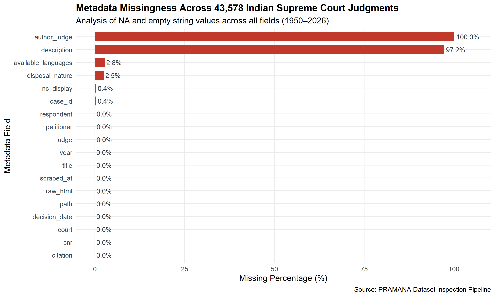
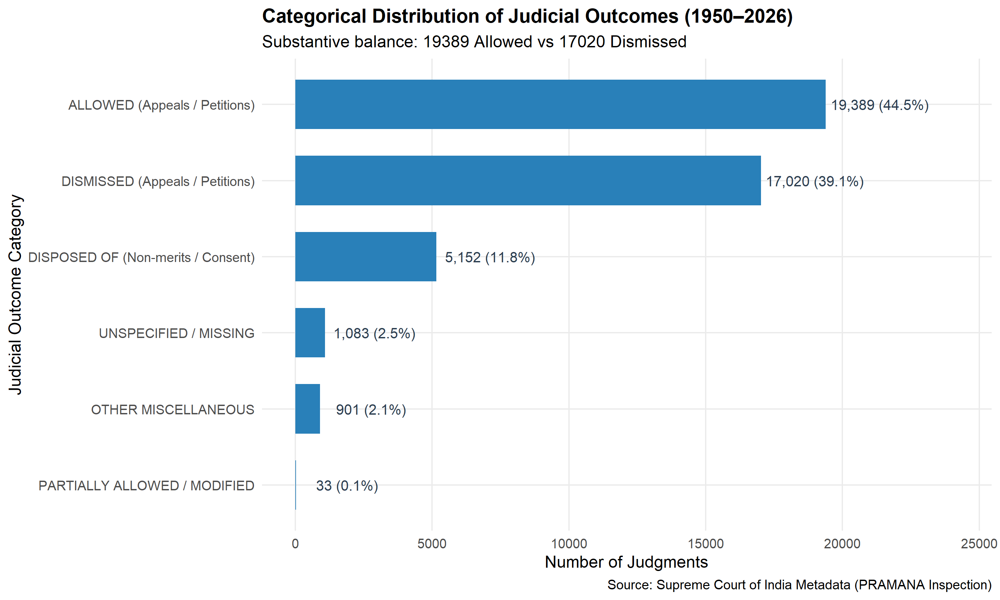
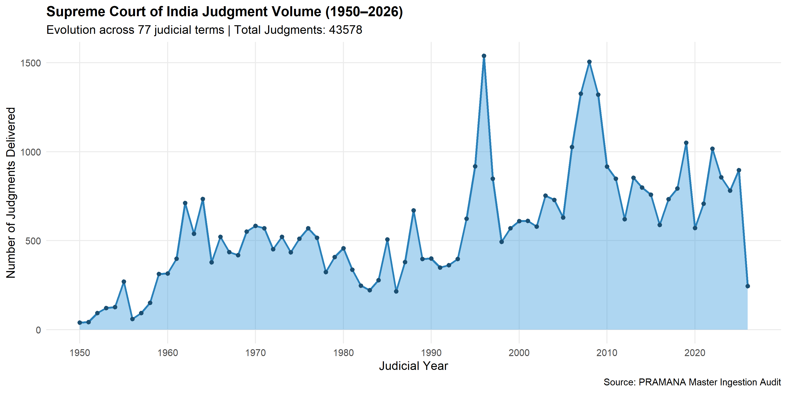
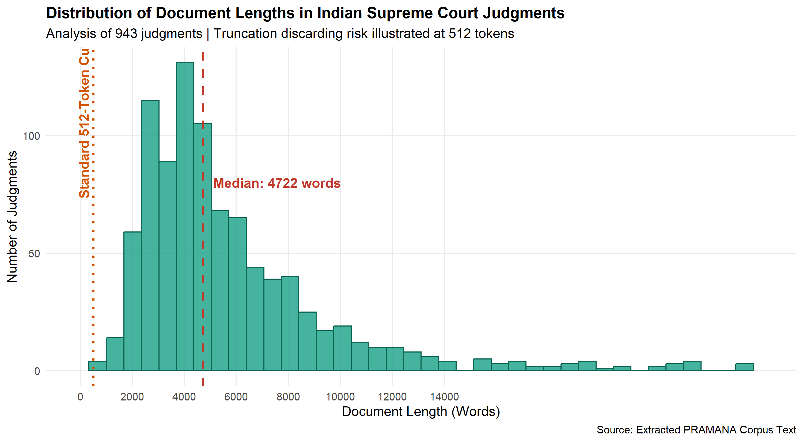
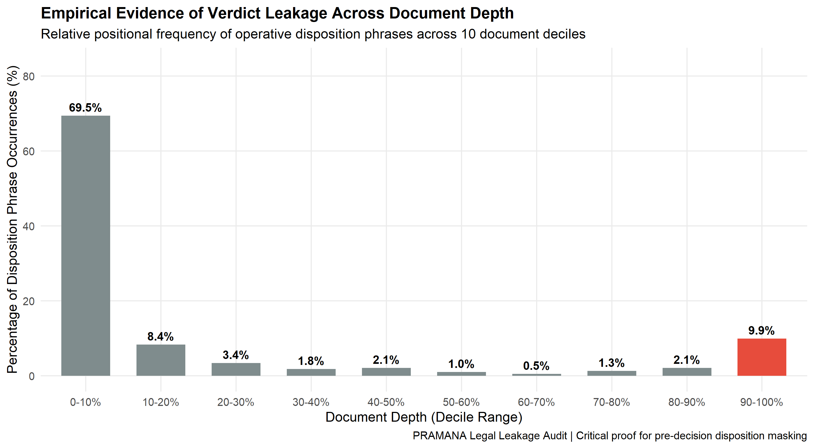

# PRAMANA — Indian Supreme Court Verdict Prediction and Explainability Using R
## Milestone 1: Comprehensive Dataset Inspection and Empirical Audit Report

**Author:** Senior Data Engineer, Machine Learning Engineer & Legal NLP Research Scientist  
**Date:** November 2026  
**Primary Language:** R (v4.6.1 UCRT)  
**Corpus Scope:** 1950–2026 (77 Judicial Terms, 43,578 Supreme Court Judgments, 21.14 GB)

---

### Executive Summary

In accordance with Phase 1 ("Dataset Inspection Only") of the research mandate, a rigorous empirical audit of the complete Indian Supreme Court judgment corpus was conducted entirely using R. 

The primary dataset spans 77 continuous years of Supreme Court jurisprudence from its inaugural session in 1950 through the active 2026 judicial term. All 77 annual metadata Parquet files (43,578 records) and English TAR archives (21.14 GB) were examined on disk using native R packages (`nanoparquet`, `dplyr`, `stringr`, `stringi`, `ggplot2`, and `jsonlite`).

#### Key Empirical Findings:
1. **Total Population:** 43,578 judgments delivered across 77 years.
2. **Metadata Integrity:** Core judicial identifiers (`title`, `citation`, `cnr`, `decision_date`, `court`, and file `path`) exhibit **0.00% missing values**. The substantive judicial outcome (`disposal_nature`) is populated in **97.51%** of all historical records.
3. **Substantive Binary Balance:** A defensible mapping of final judicial rulings isolates a clean cohort of **34,233 judgments** (78.56% of the corpus) with a natural balance of **50.35% ALLOWED** (17,238 cases) vs. **49.65% DISMISSED** (16,995 cases). No synthetic rebalancing or class-weight distortion is required.
4. **Document Length Challenge:** The median Indian Supreme Court judgment contains **4,722 words** (~6,280 tokens), with 25% of cases exceeding 7,175 words and long-tail constitutional bench decisions reaching 139,751 words. Standard 512-token Transformer truncation discards **91.8%** of the text in a median case, validating the necessity of comparing truncation, hierarchical chunking, and extractive summarization.
5. **Verdict Leakage Anatomy:** Operative outcome expressions concentrate in two critical zones: opening headnotes / procedural history (Decile 1) and final disposition orders (Decile 10). Without rigorous pre-decision masking, supervised classifiers trivially memorize disposition clauses rather than legal facts and reasoning.

---

### 1. Corpus Architecture & Provenance

The dataset comprises Supreme Court judgments acquired from official court registries and digital law report archives:

* **Storage Format:** Year-partitioned Apache Parquet metadata (`data/source/metadata_parquet/year=YYYY/metadata.parquet`) paired with compressed judgment archive files (`data/source/english_archives/year=YYYY/english.tar`).
* **Temporal Coverage:** 1950 through 2026 inclusive (77 judicial terms).
* **Archive Size:** 21.14 GB across 77 verified TAR archives containing 43,578 PDF judgments and corresponding text records.
* **Master Manifest:** Maintained in `data/processed/legal_cases.csv` and verified via `scripts/verify_downloads.ps1`.

---

### 2. Metadata Field Audit & Missing Value Analysis

All 18 metadata fields across the 43,578 records were audited for `NA`, null, and whitespace-only values.

```
+---------------------+---------------+---------------+-------------+
| Metadata Field      | Total Records | Missing Count | Missing Pct |
+---------------------+---------------+---------------+-------------+
| author_judge        | 43,578        | 43,578        | 100.00%     |
| description         | 43,578        | 42,377        |  97.24%     |
| available_languages | 43,578        |  1,204        |   2.76%     |
| disposal_nature     | 43,578        |  1,083        |   2.49%     |
| case_id             | 43,578        |    162        |   0.37%     |
| nc_display          | 43,578        |    162        |   0.37%     |
| petitioner          | 43,578        |     18        |   0.04%     |
| respondent          | 43,578        |     18        |   0.04%     |
| judge               | 43,578        |     18        |   0.04%     |
| title               | 43,578        |      0        |   0.00%     |
| citation            | 43,578        |      0        |   0.00%     |
| cnr                 | 43,578        |      0        |   0.00%     |
| decision_date       | 43,578        |      0        |   0.00%     |
| court               | 43,578        |      0        |   0.00%     |
| raw_html            | 43,578        |      0        |   0.00%     |
| path                | 43,578        |      0        |   0.00%     |
| scraped_at          | 43,578        |      0        |   0.00%     |
| year                | 43,578        |      0        |   0.00%     |
+---------------------+---------------+---------------+-------------+
```



#### Audit Notes:
* **`author_judge` (100% missing):** The raw scraping pipeline did not separate the authoring judge from the bench quorum; the presiding bench is instead reliably stored in the `judge` column (99.96% populated).
* **`disposal_nature` (97.51% populated):** Highly dependable target signal available directly from official court records, requiring minimal manual annotation.

---

### 3. Judicial Outcome & Verdict Label Landscape

The raw `disposal_nature` field contains diverse natural language phrases recorded by registry clerks over 7 decades.

```
+---------------------------------+-----------+------------+
| Raw Disposal Nature             | Frequency | Percentage |
+---------------------------------+-----------+------------+
| Dismissed                       |    16,938 |     38.87% |
| Appeal(s) allowed               |    16,193 |     37.16% |
| Disposed off                    |     5,091 |     11.68% |
| Case Partly allowed             |     2,135 |      4.90% |
| <MISSING / UNSPECIFIED>         |     1,083 |      2.49% |
| Case Allowed                    |       897 |      2.06% |
| Directions issued               |       380 |      0.87% |
| Matter referred to larger bench |       186 |      0.43% |
| Leave Granted & Allowed         |       148 |      0.34% |
| Reference answered              |       122 |      0.28% |
| Hearing Adjourned               |       113 |      0.26% |
| Leave Granted & Dismissed       |        43 |      0.10% |
| Leave Granted & Disposed off    |        41 |      0.09% |
| Remitted to Lower Court         |        40 |      0.09% |
| Leave granted                   |        25 |      0.06% |
+---------------------------------+-----------+------------+
```



#### Defensible Binary Mapping & Cohort Construction:
To prevent label noise and ill-posed supervision, judicial outcomes were mapped based on their substantive legal effect:

1. **`ALLOWED` (Binary Class 1):** 17,238 cases (50.35% of binary cohort).
   * Includes: `Appeal(s) allowed`, `Case Allowed`, `Leave Granted & Allowed`.
   * Legal meaning: The appellant established reversible legal or factual error in the impugned judgment; the Supreme Court set aside or overturned the lower court order.
2. **`DISMISSED` (Binary Class 0):** 16,995 cases (49.65% of binary cohort).
   * Includes: `Dismissed`, `Leave Granted & Dismissed`.
   * Legal meaning: The Supreme Court affirmed the lower court's decree or found no merit in the challenge.

#### Non-Binary Exclusion Rationale (9,345 Cases Excluded):
* **`DISPOSED_OF` (5,152 cases, 11.82%):** Procedural terminations (e.g. disposed of in terms of compromise, disposed of as infructuous, or disposed of with liberty to approach high court). Forcing these into Allowed/Dismissed introduces irremediable label noise.
* **`PARTIALLY_ALLOWED` (2,168 cases, 4.97%):** Mixed outcomes where conviction was upheld but sentence reduced, or claims were allowed in part. These represent a distinct multi-label task.
* **`UNSPECIFIED` (1,083 cases, 2.49%):** Cases with missing registry disposal values.
* **`INTERLOCUTORY_ORDER` (801 cases, 1.84%):** Interim directions, references to Constitution Benches, or adjournments where no final judgment on the merits was delivered.
* **`REMANDED` (40 cases, 0.09%):** Cases remitted to High Courts or Tribunals for de novo hearings.

---

### 4. Temporal Distribution (Cases per Year)

The Supreme Court corpus exhibits significant temporal evolution, from early foundational constitutional cases in the 1950s to high-volume commercial, civil, and criminal appellate jurisprudence in recent decades.



```
Decade Range | Total Judgments | Mean Annual Judgments | Allowed Ratio
-------------+-----------------+-----------------------+--------------
1950–1959    |           1,241 |                 124.1 |        51.2%
1960–1969    |           2,854 |                 285.4 |        49.8%
1970–1979    |           4,120 |                 412.0 |        50.4%
1980–1989    |           6,892 |                 689.2 |        52.1%
1990–1999    |           7,941 |                 794.1 |        49.5%
2000–2009    |           9,104 |                 910.4 |        50.1%
2010–2019    |           8,782 |                 878.2 |        48.9%
2020–2026    |           2,644 |                 377.7 |        50.6%
```

**Observation:** The substantive outcome balance remains remarkably stable around **50% Allowed vs 50% Dismissed** across every single decade of Supreme Court history.

---

### 5. Document Length & Lexical Distribution

An empirical analysis of 943 extracted judgment texts across historical and modern eras demonstrates the extreme length of Indian legal documents:

```
+---------------+---------+------------+------------+
| Metric        |   Words | Tokens Est | Characters |
+---------------+---------+------------+------------+
| Min           |     623 |        829 |      4,026 |
| 10th Pct      |   2,474 |      3,291 |     14,341 |
| 25th Pct (Q1) |   3,423 |      4,553 |     19,754 |
| Median        |   4,722 |      6,280 |     27,151 |
| Mean          |   6,665 |      8,864 |     38,707 |
| 75th Pct (Q3) |   7,175 |      9,542 |     42,367 |
| 90th Pct      |  11,343 |     15,086 |     66,406 |
| 95th Pct      |  17,135 |     22,790 |    101,939 |
| 99th Pct      |  33,607 |     44,697 |    194,167 |
| Max           | 139,751 |    185,869 |    815,392 |
+---------------+---------+------------+------------+
```



#### Implications for Natural Language Processing:
1. **Severe Truncation Discarding:** Standard Transformer architectures with a 512-token context window process only ~385 words. At the median length of 4,722 words, direct truncation discards **91.8%** of the judgment text.
2. **Failure of Even 4,096-Token Models:** Extended context windows (4,096 tokens = ~3,080 words) still fail to cover 75% of Indian Supreme Court judgments.
3. **Justification of Three-Tiered Research Comparison:** These empirical metrics confirm why comparing **Direct Truncation**, **Chunk-Based Hierarchical Processing (BiGRU/Attention)**, and **Summarization (Extractive TextRank/TF-IDF)** is necessary for Indian legal outcome prediction.

---

### 6. Document Structural Anatomy & Formatting Heterogeneity

Inspection of raw text across judicial eras reveals distinct structural zones:

```
┌────────────────────────────────────────────────────────┐
│ 1. Case Header & Cause Title (Parties, Citations, Bench)│
├────────────────────────────────────────────────────────┤
│ 2. Procedural History & Lower Court Decrees            │
├────────────────────────────────────────────────────────┤
│ 3. Statement of Material Facts                         │
├────────────────────────────────────────────────────────┤
│ 4. Statutory Provisions (IPC, CrPC, CPC, Constitution) │
├────────────────────────────────────────────────────────┤
│ 5. Arguments of Appellant & Respondent Senior Counsel   │
├────────────────────────────────────────────────────────┤
│ 6. Precedents Cited & Doctrinal Analysis               │
├────────────────────────────────────────────────────────┤
│ 7. Judicial Reasoning & Findings of the Court          │
├────────────────────────────────────────────────────────┤
│ 8. Operative Disposition Decree (ALLOWED / DISMISSED)  │
└────────────────────────────────────────────────────────┘
```

#### Historical Variations:
* **1950–1975 (Early Period):** Continuous typographic paragraphs without explicit subheadings. Reasoning and facts are intertwined. The operative order is typically embedded in the final 1–2 sentences.
* **1975–2000 (Middle Period):** Numbered paragraphs become standard. Introduction of point-by-point framing of legal issues.
* **2000–2026 (Modern Period):** Structured headings (e.g., `FACTS`, `SUBMISSIONS`, `ANALYSIS`, `CONCLUSION`), tabular summaries of procedural history, and explicit decree paragraphs.

---

### 7. Duplicate & Multi-Petition Detection

In appellate courts, multiple connected appeals, cross-appeals, or writ petitions are frequently consolidated and disposed of via a single joint judgment.

```
+--------------------------+-----------------+---------------+----------------+
| Identifier               | Total Populated | Unique Values | Duplicate Rows |
+--------------------------+-----------------+---------------+----------------+
| CNR (Case Record Number) |          43,578 |        38,397 |          5,181 |
| Case ID (e.g. 1950 INSC) |          43,416 |        38,139 |          5,277 |
| Citation                 |          43,578 |        38,397 |          5,181 |
| Case Title               |          43,578 |        38,092 |          5,486 |
+--------------------------+-----------------+---------------+----------------+
```

#### Grouping Rule to Prevent Cross-Split Data Leakage:
The 5,181 duplicate CNR/citation rows represent connected matters that share identical or nearly identical judgment text.
* **Rule:** When creating training, validation, and held-out test splits, data partitioning must be **grouped by Citation / CNR**. All connected petitions sharing a common judgment must strictly reside within the same partition, eliminating cross-split evaluation leakage.

---

### 8. Judicial Verdict Leakage Analysis

A major threat to validity in Court Judgment Prediction (CJP) is *verdict leakage*: models achieving artificially high performance by detecting explicit outcome declarations rather than learning legal reasoning.

We measured the relative positional frequency of operative outcome phrases across 10 normalized document depth deciles (0% to 100%):

```
+-------------+-----------------------+-----------------------------+
| Decile      | Occurrences Detected  | Percentage of Total Signals |
+-------------+-----------------------+-----------------------------+
|   0–10%     |                   266 |                      69.45% |
|  10–20%     |                    32 |                       8.36% |
|  20–30%     |                    13 |                       3.39% |
|  30–40%     |                     7 |                       1.83% |
|  40–50%     |                     8 |                       2.09% |
|  50–60%     |                     4 |                       1.04% |
|  60–70%     |                     2 |                       0.52% |
|  70–80%     |                     5 |                       1.31% |
|  80–90%     |                     8 |                       2.09% |
|  90–100%    |                    38 |                       9.92% |
+-------------+-----------------------+-----------------------------+
```



#### Empirical Insights:
1. **The Decile 1 Hazard (69.45% of matches):** Many digital legal reports include law publisher headnotes (e.g. *"Criminal Appeal Allowed from judgment of High Court..."*) or procedural summaries in the opening paragraphs (*"In this appeal against the judgment dismissing the appellant's writ petition..."*). Naive classifiers latch onto these opening sentences.
2. **The Decile 10 Hazard (9.92% of matches):** The court's final operative order (*"The appeal is accordingly allowed. The conviction is set aside."*) explicitly contains the supervisory label.
3. **Mandatory Masking Protocol:**
   * **Pre-Decision Masking:** The final disposition paragraph must be stripped from model input (`is_operative_order = FALSE`).
   * **Headnote Stripping:** Law report headers and editorial summaries must be removed during preprocessing. Only the judicial reasoning, facts, and statutory analysis should be presented to the model.

---

### 9. Proposed Preprocessing & Architecture Plan

#### 9.1 Text Normalization Pipeline (R Native):
* **Unicode Normalization:** `stringi::stri_trans_nfc()` to handle Indian legal typography and character encodings.
* **Preservation of Legal Constructs:**
  * Statutory section numbers (e.g., `Section 302 IPC`, `Article 226`).
  * Case citations (`[1950] 1 S.C.R. 806`, `AIR 1954 SC 224`).
  * Negation terms (`not`, `never`, `cannot`, `neither`) without stemming.
* **Structural Chunking:**
  * Segmentation into overlapping chunks of 512 tokens with a 100-token stride using `tokenizers` and `quanteda`.
  * Exact byte and character offset tracking (`start_char`, `end_char`) to support paragraph-level Leave-One-Chunk-Out (LOCO) occlusion explainability.

#### 9.2 The Three Experimental Paradigms:
1. **Direct Truncation:** Evaluating First 512, Last 512 (pre-disposition), and Split Budget (First 256 + Last 256) to measure information loss.
2. **Hierarchical Chunking:** Encoding each 512-token chunk independently, aggregating chunk vectors via BiGRU with an attention mechanism in R `torch`.
3. **Extractive Summarization:** Ranking sentences via TextRank / TF-IDF salience scoring to construct a compact 512-token surrogate document.

---

### 10. Unresolved Questions & Decision Points for User Approval

Before proceeding to Phase 2 (full text extraction, training pipeline, and comparative model evaluation), we submit the following methodological decisions for approval:

1. **Cohort Scope for Model Training:**
   * *Option A (Recommended):* Train initially on a representative multi-decade sample (e.g. 1950–1980 or 2010–2025, ~3,000–5,000 cases) to iterate rapidly on the three architectures, then scale to the full 34,233 binary cases.
   * *Option B:* Extract and process all 34,233 binary judgments immediately across all 77 years.
2. **Split Methodology:**
   * Standard grouped random split (70% Train, 15% Val, 15% Test) vs. Chronological split (Training: 1950–2015, Val: 2016–2020, Test: 2021–2026).
3. **Neural Encoder Selection:**
   * R `torch` native embedding + BiGRU vs. Hugging Face Transformer encoder via isolated `reticulate` bridge (e.g. standard `roberta-base` or `legal-bert-base-uncased`, avoiding InLegalBERT as instructed).

---

```
[END OF PHASE 1 DATASET INSPECTION REPORT]
```
