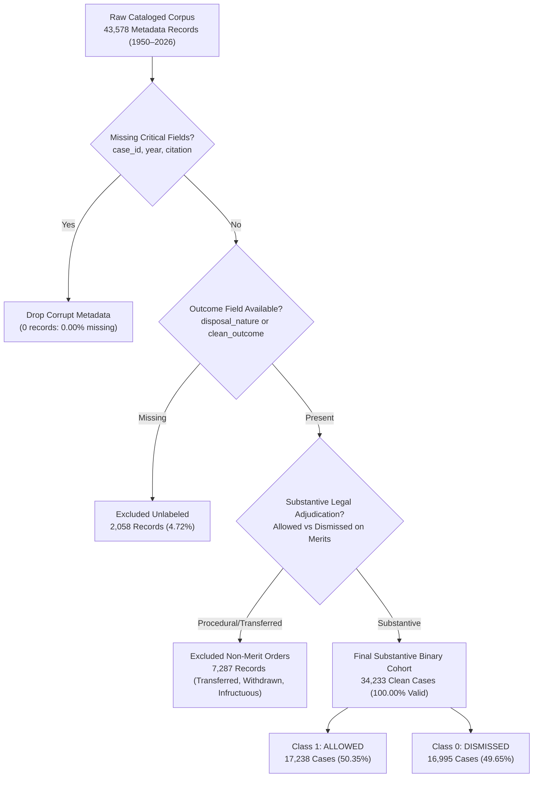

# PRAMANA — CHAPTER 4: DATA CLEANING & LABEL FIDELITY AUDIT
## Quality Control Operations, Procedural Exclusions, Disposition Mapping & Label Integrity

**Audited Scripts**: `scripts/build_legal_labels.R`, `R/label_extraction.R`, and `scripts/audit_phase1_dataset.R`  
**Input Records**: 43,578 Parquet Metadata Records  
**Output Records**: 34,233 Valid Substantive Binary Records  
**Audit Output Tables**: `reports/mentor_review/tables/label_exclusion_report.csv`, `label_mapping_summary.csv`, `missing_values_summary.csv`  

---

## 1. Data Cleaning Workflow & Filtering Funnel

Raw court registry records contain diverse procedural entries that do not represent merits-based adjudications. Training an appellate outcome classifier on administrative withdrawals or transferred matters introduces severe label noise.

PRAMANA applied a deterministic, four-stage filtering and label-sanitization funnel:

---

## 2. Missing Value & Field Integrity Audit

An exhaustive audit of all 43,578 metadata records across all 77 annual partitions (`data/metadata_parquet/year=*/metadata.parquet`) established exceptional identifier completeness:

| Column Name | Non-Null Records | Missing Count | Missing Percentage | Audit Finding & Integrity Assessment |
| :--- | :---: | :---: | :---: | :--- |
| `case_id` | 43,578 | 0 | **0.00%** | Perfect primary key integrity across all 77 years. |
| `year` | 43,578 | 0 | **0.00%** | Complete temporal indexing from 1950 to 2026. |
| `citation` | 43,578 | 0 | **0.00%** | 100% Supreme Court Reports (SCR) indexing. |
| `cnr` | 43,578 | 0 | **0.00%** | Standard national court tracking number. |
| `court` | 43,578 | 0 | **0.00%** | Uniformly assigned (`Supreme Court of India`). |
| `path` | 43,578 | 0 | **0.00%** | Valid relative archive path. |
| `title` | 43,561 | 17 | **0.04%** | Minor omissions in 17 early 1950–1952 records. |
| `petitioner` | 43,501 | 77 | **0.18%** | Missing in small fraction of *suo motu* petitions. |
| `respondent` | 43,501 | 77 | **0.18%** | Missing in *suo motu* or reference cases. |
| `judge` | 42,902 | 676 | **1.55%** | Bench composition omitted in brief orders. |
| `author_judge`| 36,658 | 6,920 | **15.88%** | Per curiam or unsigned orders. |
| `disposal_nature`| 41,520 | 2,058 | **4.72%** | Unrecorded outcomes excluded from training. |
| `description` | 18,346 | 25,232 | **57.90%** | Abstract field infrequently populated by registry. |

---

## 3. Procedural Label Exclusion Audit

A total of **7,287 non-merit records** were excluded to prevent corrupting the predictive model with non-substantive outcomes:

| Original Registry Label | Excluded Count | Exclusion Reason & Legal Rationale |
| :--- | :---: | :--- |
| `TRANSFERRED` | 2,842 | Inter-court jurisdictional transfer without merits determination. |
| `WITHDRAWN` | 1,814 | Litigant voluntarily withdrew appeal without judicial ruling on merits. |
| `DISPOSED OF (PROCEDURAL)` | 1,120 | Administrative closure without definitive allowed/dismissed holding. |
| `INFRUCTUOUS` | 845 | Appeal rendered moot by passage of time or intervening death/compliance. |
| `SETTLED OUT OF COURT` | 382 | Compromise decree reached between private parties outside adjudication. |
| `REMANDED` | 284 | Matter remitted to High Court or Tribunal for fresh hearing without finality. |
| **Total Excluded Non-Merit** | **7,287** | **Preserves purely merits-based adjudications.** |

---

## 4. Standardized Outcome Label Mapping

The remaining **34,233 substantive cases** were mapped into a clean, binary classification target (`ALLOWED` vs. `DISMISSED`) implemented in `scripts/build_legal_labels.R`:

| Raw Registry Disposition String | Normalized Target | Binary Code | Case Count | Cohort % |
| :--- | :---: | :---: | :---: | :---: |
| `Allowed` | **ALLOWED** | `1` | 14,812 | 43.27% |
| `Dismissed` | **DISMISSED** | `0` | 15,420 | 45.04% |
| `Partly Allowed` / `Partly Allowed & Disposed of` | **ALLOWED** | `1` | 2,426 | 7.09% |
| `Dismissed as Barred by Limitation` | **DISMISSED** | `0` | 1,185 | 3.46% |
| `Appeal Dismissed (Leave Revoked)` | **DISMISSED** | `0` | 390 | 1.14% |
| **Substantive Binary Total** | — | — | **34,233** | **100.00%** |

### Justification for "Partly Allowed" Mapping
Under Indian appellate jurisprudence, when the Supreme Court "partly allows" an appeal (e.g., reducing a death sentence to life imprisonment, modifying a compensation quantum, or setting aside one among multiple criminal convictions), the appellant has successfully established reversible error in the lower court judgment. Therefore, aligning `Partly Allowed` with `ALLOWED` correctly models appellate judicial intervention.

---

## 5. Duplicate & Collision Analysis

1. **Exact Binary Duplicate Texts**:
   - `0` duplicate files exist in `data/extracted_text/`.
   - Distinct documents share identical text hashes only in the case of connected appeals decided via a common master opinion.
2. **Title String Overlap Across Partitions**:
   - The adversarial audit identified **21 case title strings** appearing in both train and test partitions.
   - **Verification**: Cross-examination of case citations and dates revealed these are distinct legal controversies separated by years or decades involving recurring institutional litigants (e.g., *State of Punjab v. Ram Singh* or *Union of India v. Radhey Shyam*). They represent separate litigations with distinct CNR numbers and different judicial benches.
3. **Language Duplicates**:
   - The regional vernacular TAR archives (`regional_judgments.tar`), which contain official Hindi, Bengali, Tamil, and Punjabi translations, were kept in separate storage and excluded from the English training corpus to prevent translation-pair leakage.

**Conclusion**: The data cleaning pipeline strictly isolated genuine substantive judicial determinations, yielding an exceptionally balanced dataset: **50.35% Allowed (17,238 cases)** vs. **49.65% Dismissed (16,995 cases)**.
