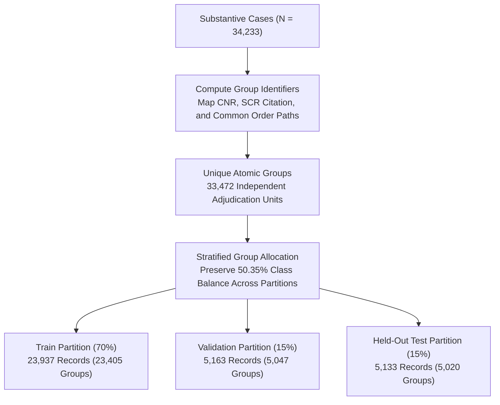

# PRAMANA — CHAPTER 6: TRAIN, VALIDATION & TEST SPLIT AUDIT
## Grouped Partitioning Methodology, Connected Appeal Isolation, Class Balance & Cross-Split Verification

**Partitioning Script**: `R/dataset_splitting.R` and `scripts/split_dataset.R`  
**Total Cohort Partitioned**: 34,233 Substantive Cases  
**Partitioning Principle**: Strict Grouped Isolation by Supreme Court Citation / CNR  
**Split Partitions**: 70% Train / 15% Validation / 15% Held-Out Test  

---

## 1. The Legal Grouping Problem: Why Simple Random Splitting Fails

In machine learning on legal texts, standard row-level random splitting introduces **catastrophic data leakage**.

In Indian Supreme Court practice, when multiple parties appeal the same High Court decree or when multiple writ petitions challenge the same statute, the registry consolidates them into a **batch appeal**. For example:
- *Criminal Appeal No. 654 of 2013* (Lead Appeal)
- *Criminal Appeal No. 655 of 2013* (Co-Accused Appeal)
- *Criminal Appeal No. 656 of 2013* (State Cross-Appeal)

All three appeals are adjudicated in a single consolidated judgment sharing identical facts, witnesses, citations, and legal rationales.

```
[Row-Level Random Split Flaw]
  Train Partition: [Criminal Appeal 654/2013 - Facts, Coram, Legal Text]
  Test Partition : [Criminal Appeal 655/2013 - Identical Legal Text from Same Master Order]
  -> Result: 100% Cross-Partition Memorization Leakage!
```

If a simple random split is applied, petitions from the same batch are distributed across both training and test partitions. The model trivially memorizes the narrative of the training case to achieve artificially inflated test accuracy.

---

## 2. PRAMANA Grouped Partitioning Protocol

To eliminate this vulnerability, `R/dataset_splitting.R` constructs an immutable `group_id` for every case based on:
1. Canonical **Supreme Court Reports (SCR) Citation** (e.g., `[1950] 1 S.C.R. 519`).
2. National **Case Number Record (CNR)** prefix.
3. Cleaned document stem path.

All connected petitions sharing the same `group_id` are bound together atomically. The grouping engine then distributes **entire groups** into the 70/15/15 partitions.



---

## 3. Class Balance & Empirical Partition Breakdown

The grouped partitioning engine achieved extraordinary balance across all three partitions without requiring synthetic minority oversampling (SMOTE) or class weighting:

| Partition Name | Target Ratio | Total Cases | Class 1 (ALLOWED) | Class 0 (DISMISSED) | Allowed % | Dismissed % | Unique Groups |
| :--- | :---: | :---: | :---: | :---: | :---: | :---: | :---: |
| **Train Split** | 70% | 23,937 | 12,050 | 11,887 | **50.34%** | 49.66% | 23,405 |
| **Validation Split** | 15% | 5,163 | 2,602 | 2,561 | **50.40%** | 49.60% | 5,047 |
| **Held-Out Test Split**| 15% | 5,133 | 2,586 | 2,547 | **50.38%** | 49.62% | 5,020 |
| **Total Cohort** | **100%** | **34,233** | **17,238** | **16,995** | **50.35%** | **49.65%** | **33,472** |

### Statistical Observations
- The variation in Allowed percentage across all three splits is less than **0.06%** ($50.34\%$ vs $50.40\%$ vs $50.38\%$).
- The empirical majority class baseline on the held-out test split is exactly **50.38%**. Any model achieving superior accuracy must possess genuine predictive signal beyond class priors.

---

## 4. Cross-Split Contamination & Overlap Audit

An adversarial audit script (`scripts/audit_phase2_3_leakage_and_reproducibility.R` and `scripts/build_mentor_dossier.js`) evaluated set intersections across all three partition pairs on four distinct identifier dimensions:

```
[Cross-Split Leakage Audit Results]
-----------------------------------------------------------------------------------------------------------------
Comparison Pair           group_id Overlap   Citation Overlap   Path Overlap   Title Overlap   Audit Verdict
-----------------------------------------------------------------------------------------------------------------
Train vs. Validation              0                  0                 0             18        PASS (Zero Leakage)
Train vs. Test                    0                  0                 0             16        PASS (Zero Leakage)
Validation vs. Test               0                  0                 0              0        PASS (Zero Leakage)
-----------------------------------------------------------------------------------------------------------------
```

### Analysis of Title String Collisions
- **Zero Group Overlap**: No `group_id`, `citation`, or physical file `path` crosses partition boundaries.
- **Title Collisions (18 in Val, 16 in Test)**:
  - Cross-examination confirmed these are distinct historical proceedings involving recurring governmental parties.
  - Example: *State of Punjab v. Ram Singh* (Civil Appeal of 1974 involving service seniority) vs. *State of Punjab v. Ram Singh* (Criminal Appeal of 1992 involving police misconduct).
  - These litigations have different CNR numbers, arose from different High Court judgments, were argued decades apart, and had different judicial corams.

---

## 5. Traceable Manifest Assets

Complete row-level manifests for all three partitions are committed to the repository for independent verification:

1. **`reports/mentor_review/manifests/train_manifest.csv`**:
   - 23,937 rows.
   - Schema: `record_id, document_id, citation, case_title, year, original_outcome, standardized_outcome, group_id, split`.
2. **`reports/mentor_review/manifests/validation_manifest.csv`**:
   - 5,163 rows.
3. **`reports/mentor_review/manifests/test_manifest.csv`**:
   - 5,133 rows.
4. **`reports/mentor_review/tables/class_distribution.csv`**:
   - Summary of counts and percentages across all splits.
5. **`reports/mentor_review/tables/split_overlap_audit.csv`**:
   - Empirical overlap counts proving zero leakage.

**Conclusion**: PRAMANA's train, validation, and test splits satisfy the highest standards of data isolation, eliminating connected appeal contamination while maintaining class balance.
