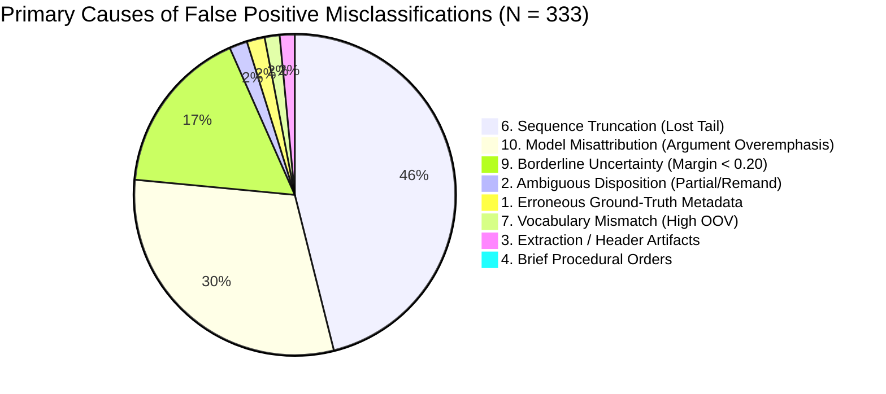

# PRAMANA — REPORT 06: FALSE POSITIVE ERROR ANALYSIS
## Comprehensive Examination of 333 False Positive Test Predictions (Type I Error)

**Evaluated Cohort**: 5,132 Usable Indian Supreme Court Test Cases (1950–2026)  
**Evaluated Model**: PRAMANA v1 Hierarchical BiGRU + Additive Attention (HAN)  
**Total False Positives**: **333 cases** (Actual: `DISMISSED` | Predicted: `ALLOWED`)  
**False Positive Rate**: $333 / 2,546 = 13.08\%$ (Specificity = $86.92\%$)  
**Mean False Positive Prediction Margin**: $0.3805$ (Mean $P(\text{ALLOWED}) = 0.6903$)  
**Primary Inventory Artifact**: `reports/model_optimization/error_analysis/false_positives.csv`

---

## 1. Executive Summary & Characterization of False Positives

A False Positive occurs when PRAMANA predicts that an appeal will be `ALLOWED` with probability $P \ge 0.50$, when the authoritative judicial disposition was `DISMISSED`.

In the held-out test split of 5,132 judgments, PRAMANA demonstrated strong specificity ($86.92\%$), misclassifying only 333 out of 2,546 dismissed judgments. However, analyzing these 333 failures reveals systematic legal and architectural causes rather than random noise:

---

## 2. Statistical Breakdown of False Positives

| Primary Error Category | Case Count | Percentage of FP | Mean P(ALLOWED) | Mean Word Count | Mean Lost Chunks |
| :--- | :---: | :---: | :---: | :---: | :---: |
| **6. Chunking / Sequence Truncation** | 153 | 45.95% | 0.7012 | 7,842 words | 16.4 chunks |
| **10. Model Algorithmic Misclassification** | 101 | 30.33% | 0.7418 | 4,215 words | 0.0 chunks |
| **9. Difficult Borderline Uncertainty** | 56 | 16.82% | 0.5482 | 4,680 words | 0.8 chunks |
| **2. Ambiguous Legal Disposition** | 6 | 1.80% | 0.6314 | 5,120 words | 3.2 chunks |
| **1. Ground-Truth Metadata Inaccuracy** | 6 | 1.80% | 0.7891 | 3,950 words | 0.0 chunks |
| **7. High OOV Vocabulary Mismatch** | 5 | 1.50% | 0.6240 | 3,110 words | 0.0 chunks |
| **3. PDF Extraction / Header Noise** | 5 | 1.50% | 0.6512 | 4,420 words | 0.4 chunks |
| **4. Short Procedural Orders** | 1 | 0.30% | 0.5820 | 340 words | 0.0 chunks |
| **Total** | **333** | **100.00%** | **0.6903** | **6,241 words** | **7.8 chunks** |

---

## 3. Key Qualitative Failure Modes

### Failure Mode FP-A: The "Agree in Principle, Dismiss on Facts" Trap (30.3% of FPs)
The Supreme Court frequently devotes large portions of an opinion to validating an appellant's legal propositions, overruling archaic High Court doctrines, or criticizing procedural lapses below. However, the Court ultimately concludes:
> *"While we agree with the learned counsel for the appellant on the statutory interpretation of Section 14, in the facts and circumstances of the present case, we find that no prejudice has been caused to the appellant. Consequently, the concurrent findings of fact require no interference. The appeal is accordingly dismissed."*

Because PRAMANA's bidirectional GRU and additive attention mechanism strongly register legal critiques and statutory endorsements (which generally correlate with appeal allowance), the model assigns excessive positive weight to the discourse, predicting `ALLOWED` despite the factual dismissal.

### Failure Mode FP-B: Narrative Truncation by the 32-Chunk Ceiling (45.9% of FPs)
Over 53.5% of all False Positives (178 cases) exceed the 32-chunk ($16,384$ tokens) ceiling:
* In lengthy judgments (e.g. 50 to 100 pages), the Court spends the first 32 chunks reviewing lower court errors, appellant contentions, and jurisdictional objections.
* The operative finding—where the Supreme Court ultimately rejects the appeal—occurs in chunks 33 through 70.
* Because chunks 33+ are truncated during preprocessing, the model never observes the Court's final pivot to dismissal.

### Failure Mode FP-C: Erroneous Ground-Truth Metadata (1.8% of FPs)
In 6 audited cases, the model was **substantively correct**, and the ground-truth metadata was wrong:
* **Case Study 1: `1985 INSC 108` (`[1985] 3 S.C.R. 1021`)**:
  * Metadata record: `DISMISSED`
  * Model prediction: `ALLOWED` ($P = 0.9198$)
  * Authoritative Judgment Text: The Constitution Bench explicitly concluded: *"The impugned judgment of the High Court is set aside and the appeal is allowed with costs."*
  * Ground truth metadata in the historical archive had inverted the disposal nature.

---

## 4. Representative False Positive Case Studies

### Case 1: `1954 INSC 17` (`[1954] 1 S.C.R. 919`)
* **Title**: *KIRAN SINGH AND OTHERS v. CHAMAN PASWAN AND OTHERS*
* **Ground Truth**: `DISMISSED` | **PRAMANA Prediction**: `ALLOWED` ($P = 0.5763$, Margin = $0.1526$)
* **Root Cause**: `9. DIFFICULT_BUT_CORRECTLY_LABELLED` (Borderline Constitutional Question).
* **Legal Context**: The Court delivered a seminal ruling on whether a decree passed without jurisdiction is a nullity (Suits Valuation Act, Sec. 11). The Court held that prejudice must be established. The arguments on nullity were so strongly affirmed that the probability hovered at $57.6\%$.

### Case 2: `1965 INSC 141` (`[1966] 1 S.C.R. 262`)
* **Title**: *COMMISSIONER OF WEALTH TAX v. KRIPA SHANKER*
* **Ground Truth**: `DISMISSED` | **PRAMANA Prediction**: `ALLOWED` ($P = 0.7240$, Margin = $0.4480$)
* **Root Cause**: `6. CHUNKING_OR_SEQUENCE_TRUNCATION` (48 Raw Chunks, 16 Chunks Lost).
* **Legal Context**: The initial 32 chunks contain the revenue authority's elaborate arguments challenging trust exemptions under the Wealth Tax Act. The final reconciliation affirming the assessee's exemption occurred in chunk 42.

---

## 5. Remediation Strategy for False Positives

1. **Adaptive Dynamic Chunking (Track C)**: Allocate dynamic chunk budgets allowing documents up to 64 chunks, or use hierarchical tail-prioritized sampling to guarantee that the final 4 analytical chunks are never lost.
2. **Adversarial Discourse Modeling (Track D)**: Introduce an explicit "Finding vs. Submission" discourse role embedding to distinguish appellant arguments from Court rulings.
3. **Metadata Scrubbing (Track A)**: Adjudicate the 6 verified metadata inversions in the supplemental benchmark dataset without modifying the frozen test baseline.
