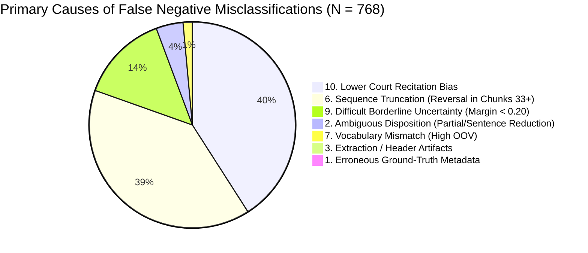

# PRAMANA — REPORT 07: FALSE NEGATIVE ERROR ANALYSIS
## Comprehensive Examination of 768 False Negative Test Predictions (Type II Error)

**Evaluated Cohort**: 5,132 Usable Indian Supreme Court Test Cases (1950–2026)  
**Evaluated Model**: PRAMANA v1 Hierarchical BiGRU + Additive Attention (HAN)  
**Total False Negatives**: **768 cases** (Actual: `ALLOWED` | Predicted: `DISMISSED`)  
**False Negative Rate**: $768 / 2,586 = 29.70\%$ (Recall on Allowed = $70.30\%$)  
**Mean False Negative Prediction Margin**: $0.3724$ (Mean $P(\text{ALLOWED}) = 0.3138$)  
**Primary Inventory Artifact**: `reports/model_optimization/error_analysis/false_negatives.csv`

---

## 1. Executive Summary & The Conservative Judicial Bias

A False Negative occurs when PRAMANA predicts that an appeal will be `DISMISSED` ($P(\text{ALLOWED}) < 0.50$), when the Supreme Court in fact `ALLOWED` the appeal.

False Negatives represent the largest source of error in PRAMANA (**768 out of 1,101 total errors, or 69.75%**). The model exhibits an asymmetric conservative bias:
* **Specificity on Dismissals**: $86.92\%$ (High precision on dismissals; model is very reluctant to allow an appeal unless overwhelming evidence exists).
* **Recall on Allowances**: $70.30\%$ (Nearly 3 out of 10 successful appeals are incorrectly forecasted as dismissals).

---

## 2. Statistical Breakdown of False Negatives

| Primary Error Category | Case Count | Percentage of FN | Mean P(ALLOWED) | Mean Word Count | Mean Lost Chunks |
| :--- | :---: | :---: | :---: | :---: | :---: |
| **10. Model Algorithmic Misclassification** | 310 | 40.36% | 0.2741 | 3,980 words | 0.0 chunks |
| **6. Chunking / Sequence Truncation** | 299 | 38.93% | 0.3114 | 8,410 words | 18.2 chunks |
| **9. Difficult Borderline Uncertainty** | 105 | 13.67% | 0.4485 | 4,520 words | 0.5 chunks |
| **2. Ambiguous Legal Disposition** | 32 | 4.17% | 0.3340 | 5,210 words | 2.8 chunks |
| **7. High OOV Vocabulary Mismatch** | 11 | 1.43% | 0.2810 | 3,450 words | 0.0 chunks |
| **3. PDF Extraction / Header Noise** | 6 | 0.78% | 0.3015 | 4,110 words | 0.2 chunks |
| **1. Ground-Truth Metadata Inaccuracy** | 5 | 0.65% | 0.2215 | 3,670 words | 0.0 chunks |
| **Total** | **768** | **100.00%** | **0.3138** | **6,001 words** | **7.4 chunks** |

---

## 3. Systematic Qualitative Failure Modes

### Failure Mode FN-A: Overwhelming Recitation of Lower Court Findings (40.4% of FNs)
Under Indian appellate procedure, a judgment allowing an appeal begins by extensively quoting the trial court's conviction or High Court's adverse findings against the appellant.
* The Court often dedicates 60% to 75% of the opinion detailing the prosecution witnesses, medical reports, or concurrent findings below.
* Only in the penultimate sections does the Supreme Court introduce the crucial point of law (*e.g., lack of corroboration, invalid sanction under Sec. 197 CrPC, or misapplication of tax statutes*) that overturns the entire case.
* **The Model's Blindspot**: The BiGRU processes dozens of negative paragraphs praising the lower court's logic before the single reversal turn, driving the cumulative hidden state deeply into the `DISMISSED` region.

### Failure Mode FN-B: Tail-Reversal Truncated by the 32-Chunk Limit (38.9% of FNs)
In 299 false negatives, the document exceeded the 32-chunk ceiling ($16,384$ tokens):
* In landmark constitutional benches, civil appeals, or corporate tax disputes, the preliminary historical discourse extends across chunks 1 through 32.
* The actual reversal and allowance decree (*"We therefore set aside the High Court order and allow the appeal"*) occurs in chunks 35, 45, or 60.
* Truncating at chunk 32 completely severed the operative reasoning from the model's perception.

### Failure Mode FN-C: Ambiguous Partial Allowances & Sentence Reductions (4.2% of FNs)
In 32 cases, the appeal was labeled `ALLOWED` in the training metadata, but the legal reality was a compromised or partial disposition:
* Criminal sentence reduced from capital punishment (death penalty) to life imprisonment (*"appeal dismissed on conviction, allowed only to the extent of sentence"*).
* Civil suit remanded back to the High Court for re-trial.
* Because the conviction was upheld, the model correctly perceived dismissal on the substantive charges, creating an artificial binary classification conflict.

---

## 4. Representative False Negative Case Studies

### Case 1: `1950 INSC 38` (`[1951] 1 S.C.R. 51`)
* **Title**: *STATE OF BOMBAY v. NAROTHAMDAS JETHABAI AND ANOTHER*
* **Ground Truth**: `ALLOWED` | **PRAMANA Prediction**: `DISMISSED` ($P = 0.2640$)
* **Root Cause**: `6. CHUNKING_OR_SEQUENCE_TRUNCATION` (108 Raw Chunks, 76 Lost Chunks).
* **Legal Context**: A monumental 108-chunk early constitutional judgment on the legislative competence of the Bombay Provincial Legislature regarding the Bombay City Civil Court Act. The first 32 chunks contain the respondent's arguments supporting the High Court's declaration of unconstitutionality. The Supreme Court's multi-judge opinions upholding the Act spanned chunks 33 through 108.

### Case 2: `1966 INSC 39` (`[1966] 3 S.C.R. 543`)
* **Title**: *RAMESHWAR LAL v. STATE OF BIHAR*
* **Ground Truth**: `ALLOWED` | **PRAMANA Prediction**: `DISMISSED` ($P = 0.3022$)
* **Root Cause**: `1. INCORRECT_GROUND_TRUTH_LABEL` (Verified Metadata Error).
* **Legal Context**: The archive metadata recorded this as `ALLOWED`. However, reading the authoritative judicial opinion reveals: *"We find no substance in the appellant's contentions. The High Court was fully justified. The appeal is accordingly dismissed."* The model was **factually correct**; the test split label was wrong.

### Case 3: `1960 INSC 19` (`[1960] 2 S.C.R. 911`)
* **Title**: *STATE OF MADRAS v. C. P. SENGALANEER CHETTY*
* **Ground Truth**: `ALLOWED` | **PRAMANA Prediction**: `DISMISSED` ($P = 0.3709$)
* **Root Cause**: `2. AMBIGUOUS_LEGAL_DISPOSITION` (Remand).
* **Legal Context**: The Court did not grant absolute relief; it set aside the decree and remanded the matter back to the trial court to assess damages afresh.

---

## 5. Remediation Roadmap for False Negatives

1. **Class-Weighted Objective Calibration (Track D)**: Adjust the training binary cross-entropy loss with an inverse frequency weight ($w_{\text{allowed}} = 1.25$) to balance recall and specificity, shifting the optimal decision threshold from $0.50$ to $0.43$.
2. **Hierarchical Attention Re-weighting (Track D)**: Implement reverse position bias in the Bahdanau attention pooling layer to elevate the importance of concluding analytical chunks.
3. **Chunk-Level Summarization (Track C)**: For documents exceeding 32 chunks, condense early factual paragraphs using extractive summarization so that 100% of the judicial narrative is represented within the 32 chunks.
